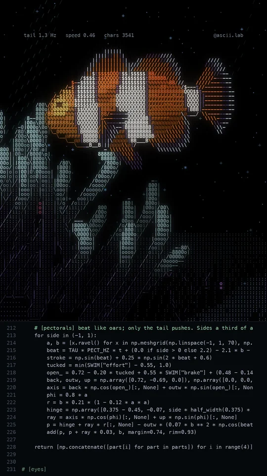

# 01 · Clownfish & anemone

[Watch on Instagram](https://www.instagram.com/reel/Df8L4ZnN4sX/) · [Scene page](https://sapozhkov.github.io/ascii-lab-public/01-clownfish/) · [Explore the model](https://sapozhkov.github.io/ascii-lab-public/01-clownfish/model.html)

The tail drives the fish through the water. The anemone’s tentacles bend and light up when the fish brushes past them.



| File | What it does |
| --- | --- |
| [clownfish.py](clownfish.py) | Simulates the scene and draws it as a character grid. Exports a still or a silent video. |
| [model.html](https://sapozhkov.github.io/ascii-lab-public/01-clownfish/model.html) | Plots the fish’s path and forces over the 22-second loop. The file can also run locally in a browser. |

## Run the renderer

Use Python 3.10 or later and install NumPy and Pillow. For MP4 output, install FFmpeg with H.264 encoding support and make it available on your PATH.

```sh
python3 -m pip install numpy Pillow
python3 clownfish.py png 3.0 frame.png
python3 clownfish.py mp4 clownfish.mp4
```

The renderer tries Menlo, DejaVu Sans Mono, and Consolas. If they are unavailable, set `ASCII_LAB_FONT` to the path of a monospace TTF or TTC font. Add `--no-code` to hide the code panel or `--duration 2` to render a short MP4 test.

The composition was inspired by a photo by Nhobgood on Wikimedia Commons.
