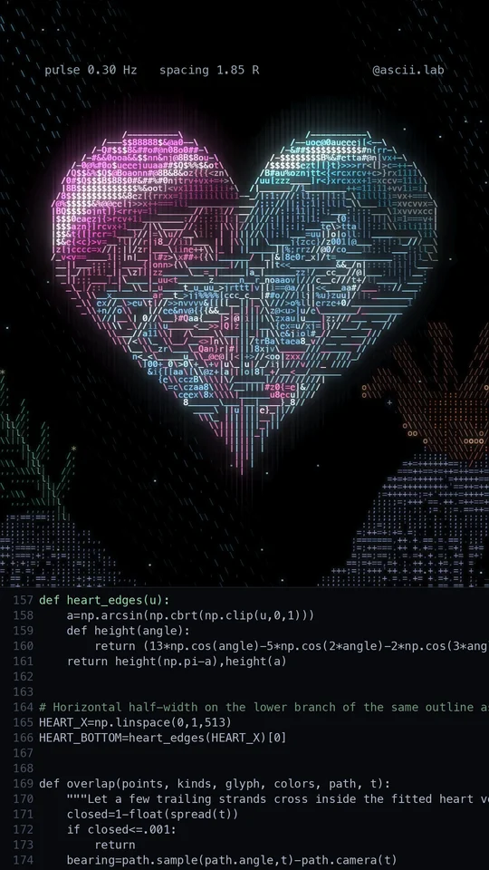

# 02 · Jellyfish heart

[Watch on Instagram](https://www.instagram.com/reel/DgBKcSYN73Y/) · [Scene page](https://sapozhkov.github.io/ascii-lab-public/02-jellyfish-heart/) · [Explore the model](https://sapozhkov.github.io/ascii-lab-public/02-jellyfish-heart/model.html)

Two ASCII jellyfish spiral upward together. Seen from the side, their bells and tentacles form a heart.

The interactive model pairs the silent ASCII scene with geometry sampled from the Python simulation at each of its 600 frames. Use the timeline to compare the swimming geometry with the final pose and see how the camera moves around the pair.
