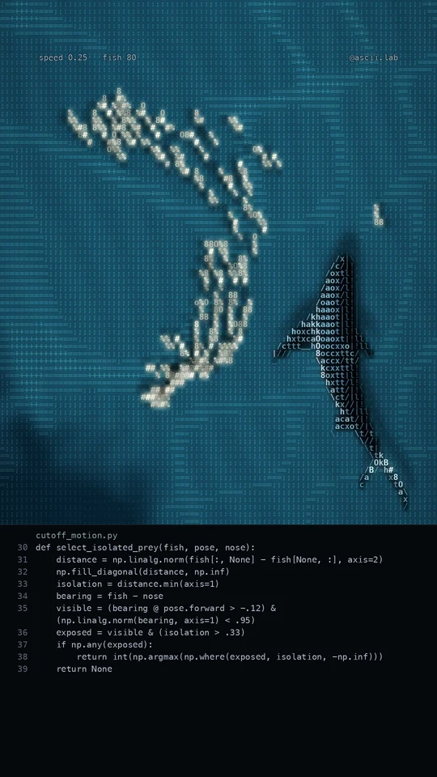

# 03 · Shark intercept

[Watch on Instagram](https://www.instagram.com/reels/DgJKEEjIquH/) · [Scene page](https://sapozhkov.github.io/ascii-lab-public/03-shark-intercept/) · [Explore the model](https://sapozhkov.github.io/ascii-lab-public/03-shark-intercept/model.html)

A shark approaches a school of 80 fish. One breaks away. A segmented spine, tail thrust and water drag drive the pursuit. The counter drops on contact at 7.58 seconds. The next school enters before the end of the 20-second loop.



| File | What it does |
| --- | --- |
| [cutoff_render.py](source/proto/shark_studies/cutoff_render.py) | Renders the ASCII scene and exports a silent MP4 and its synchronized model. |
| [cutoff_motion.py](source/proto/shark_studies/cutoff_motion.py) | Simulates the school, pursuit, and contact. |
| [dive_pose.py](source/proto/shark_studies/dive_pose.py) | Calculates swimming motion and tail thrust. |
| [cutoff_view.html](source/proto/shark_studies/cutoff_view.html) | Provides the standalone HTML template used by the renderer. |
| [tail_reaction.py](source/tail_reaction.py) | Standalone example of the axial tail reaction shown on the scene page. |

## Run the renderer

Use Python 3.9 or later, FFmpeg with libx264 and the Menlo font included with macOS. From this directory, run:

```sh
cd source
python3 -m pip install -r requirements.txt
python3 -m proto.shark_studies.cutoff_render
```

Open `source/output/cutoff.mp4` for the reel or `source/output/model.html` for the matching model and frame scrubber. The export is 1080 × 1920 at 24 frames per second. The Instagram release adds music.

The code card opens the main renderer. Its preview shows the standalone tail reaction example, which uses the same formula as the swimmer model. Run `python3 source/tail_reaction.py` from this directory to try it.

The swimming model uses a simplified tail reaction, body drag and articulated spine. Its hydrodynamic coefficients were tuned for this scene. See the references in `source/proto/shark_studies/dive_pose.py`.
