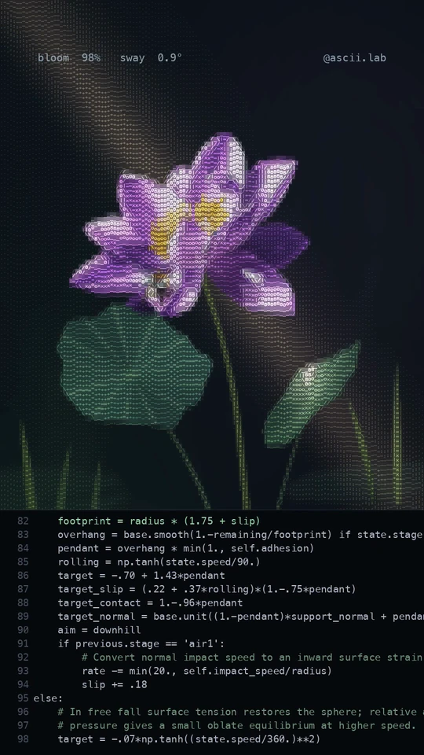

# 04 · Lotus

[Scene page](https://sapozhkov.github.io/ascii-lab-public/04-lotus/) · [Explore the model](https://sapozhkov.github.io/ascii-lab-public/04-lotus/model.html)

A purple lotus opens after rain. A bumblebee lands, and a drop rolls from a leaf into the pond. A silent, 20-second ASCII loop.



| File | What it does |
| --- | --- |
| [lotus.py](lotus.py) | Play the scene or export a frame or a video. |
| [`runtime/leaf_flow.py`](runtime/leaf_flow.py) | Source for the calculation shown on the release page. |
| [`runtime/`](runtime/) | The scene simulation, ASCII renderer and petal colors. |
| [`model.html`](model.html) | The synchronized motion diagram and event controls. |

## Run the renderer

Run the commands from this folder on macOS. The renderer was tested with Python 3.9.25, FFmpeg with libx264 and Apple Clang. It uses the system Menlo font. To install the pinned dependencies in a virtual environment:

```sh
python3.9 -m venv .venv
source .venv/bin/activate
python3 -m pip install -r requirements.txt
```

### Play in the terminal

```sh
python3 lotus.py terminal
```

### Export a PNG frame

```sh
python3 lotus.py png --time 13.8 --output lotus.png
```

### Render an MP4

```sh
python3 lotus.py mp4 --output lotus.mp4
```

The PNG and MP4 commands write to the paths given with `--output`. The MP4 is a silent 810 × 1440 loop at 30 frames per second. The model shows the same 20-second timeline.

Petal colors were sampled from the lotus in [Kail Designs’ ASCII Magic demo](https://www.youtube.com/watch?v=Hhz1lhoViNk&t=6s).
