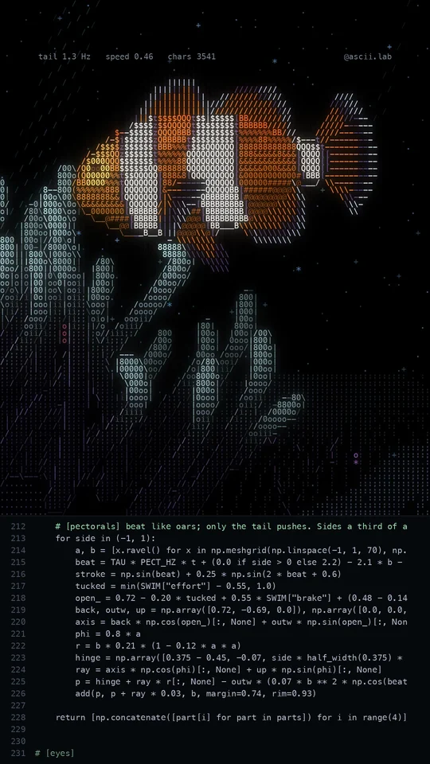
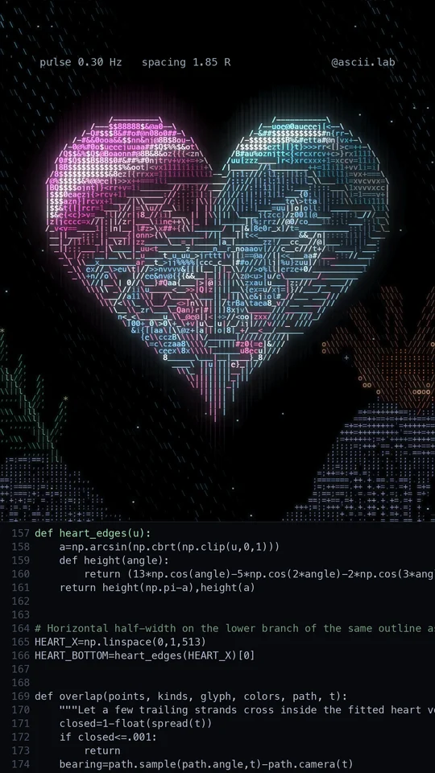
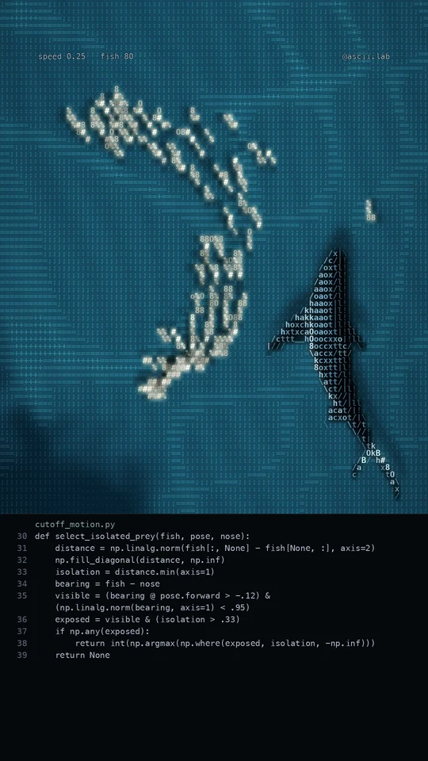
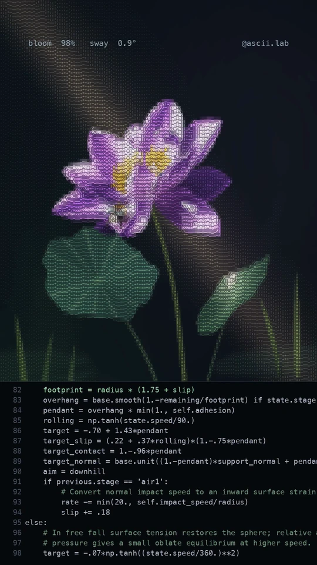

# ASCII Lab

Source code and interactive models for the procedural ASCII reels at [@ascii.lab](https://www.instagram.com/ascii.lab/).

[Open the gallery](https://sapozhkov.github.io/ascii-lab-public/)

Each reel's README shows how to play the animation in a terminal, export a PNG frame at a chosen time, and render an MP4.

| 01 · Clownfish & anemone | 02 · Jellyfish heart | 03 · Shark intercept | 04 · Lotus |
| --- | --- | --- | --- |
|  |  |  |  |
| [Code and model](01-clownfish/) | [Code and model](02-jellyfish-heart/) | [Code and model](03-shark-intercept/) | [Code and model](04-lotus/) |
