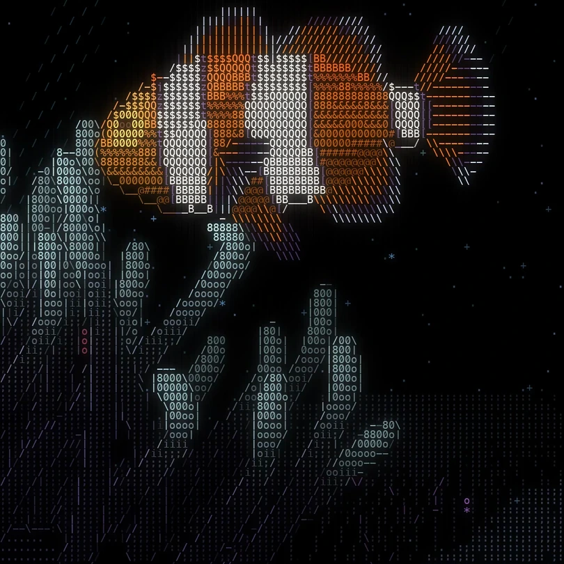
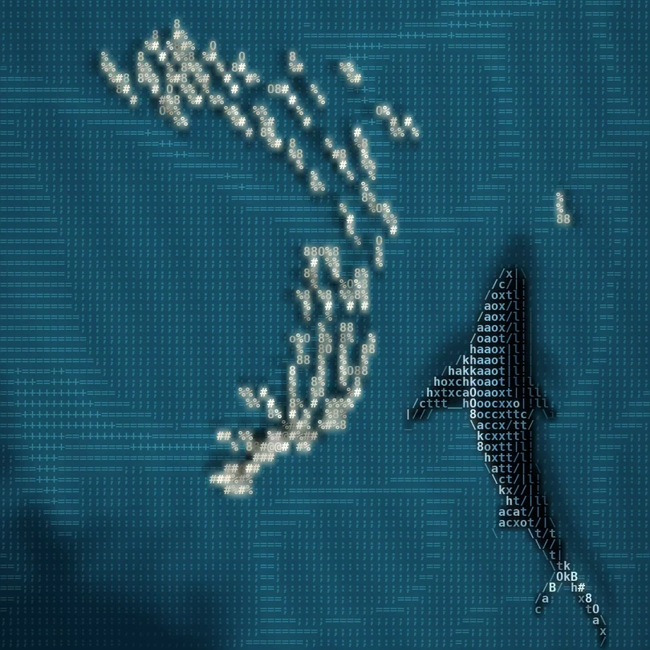

# ASCII Lab

Source code and interactive models for the procedural ASCII reels at [@ascii.lab](https://www.instagram.com/ascii.lab/).

[Open the gallery](https://sapozhkov.github.io/ascii-lab-public/)

Each reel's README shows how to play the animation in a terminal, export a PNG frame at a chosen time, and render an MP4.

| <a href="01-clownfish/">01 · Clownfish &amp; anemone</a> | <a href="02-jellyfish-heart/">02 · Jellyfish heart</a> | <a href="03-shark-intercept/">03 · Shark intercept</a> | <a href="04-lotus/">04 · Lotus</a> |
| :---: | :---: | :---: | :---: |
|  |  |  |  |
| [Code&nbsp;and&nbsp;model](01-clownfish/) | [Code&nbsp;and&nbsp;model](02-jellyfish-heart/) | [Code&nbsp;and&nbsp;model](03-shark-intercept/) | [Code&nbsp;and&nbsp;model](04-lotus/) |
